<div align="center">

<picture>
  <source media="(prefers-color-scheme: dark)" srcset="docs/media/mark-dark.svg">
  
</picture>

<h1>Surprisal Live Kit</h1>

<p><b>Live polls, word clouds, quizzes and Q&amp;A for any room.</b><br>
People join on their phone with a 4-letter code. No app, no account.<br>
An open-source, self-hosted alternative to Mentimeter, Slido and Kahoot.</p>

<p>
  <a href="#quick-start">Quick start</a> ·
  <a href="#deploy">Deploy</a> ·
  <a href="#make-it-yours">Make it yours</a> ·
  <a href="#roadmap-and-known-issues">Roadmap</a> ·
  <a href=".github/CONTRIBUTING.md">Contributing</a>
</p>

<p>
  <a href="https://github.com/habit-ai/surprisal-live-kit/actions/workflows/ci.yml"></a>
  <a href="LICENSE"></a>
  <a href="https://github.com/habit-ai/surprisal-live-kit/stargazers"></a>
  
  
  
  <a href=".github/CONTRIBUTING.md"></a>
</p>

<br>

<picture>
  <source media="(prefers-color-scheme: dark)" srcset="docs/media/hero-dark.png">
  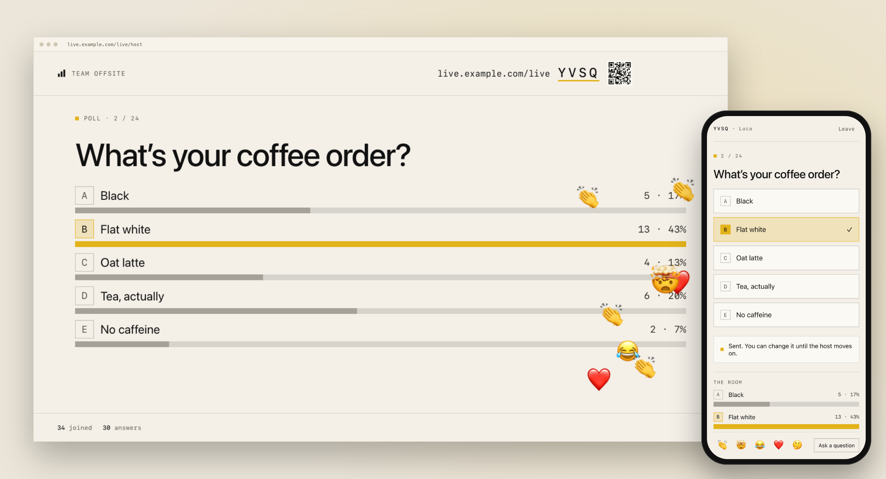
</picture>

</div>

<br>

Share the presenter screen in a call or put it on a projector. People scan the QR code, type their name and answer
on their phone. The screen counts the answers as they arrive, and the results stay hidden until you reveal them.

It is one repository that you deploy to the free plans of Vercel and Supabase. Your name and logo go on the screen,
and the answers stay in your own database.

<div align="center">
  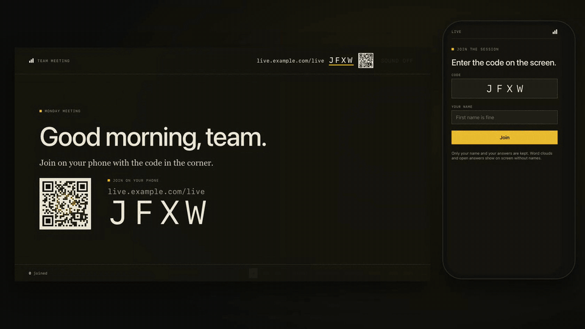
  <p><sub>Nine people join, a phone votes, the host reveals the results and the room reacts. Recorded with <code>npm run screenshots</code>.</sub></p>
</div>

## Features

- 🗳️ **12 slide types.** Polls (bars, columns, donut, multi-select), word clouds, open text, scales (1 to 5, 1 to 10,
  agree / disagree), ranking, 100 points, prediction, 2×2, timed quizzes with points and a podium, leaderboards, and
  Q&A with upvotes.
- 🙈 **Results wait for you.** The screen counts the answers as they arrive. Open answers show as face-down cards.
  Press **Reveal results** or the R key when the room is ready.
- 👏 **Reactions.** 👏 🤯 😂 ❤️ 🤔 rise on the screen, and the phone confirms each one.
- 🚪 **Doors open.** The first slide shows the QR code and the join code. Each name that joins falls onto a pile of cards.
- ⚖️ **Before and after.** Ask a poll or a scale again after the talk, and the screen shows how the room moved.
- 🎛️ **A console for the host.** Notes, the next slide, held answers and every control, in a second window or on
  your phone. The room does not see it.
- 🧹 **A word filter.** Answers with swear words or slurs (English, Swedish, Portuguese) wait in the console until
  you approve them.
- 📊 **A report after each session.** A CSV and JSON export, and a Markdown write-up to paste into a follow-up email.
- 🏷️ **White-label.** Your name, logo, colours, fonts and join address.
- 🔒 **Nothing to sign up for.** A person is a random id on the phone plus the name they type. The app collects no
  email addresses.
- 🌗 Light and dark, keyboard shortcuts, self-paced decks for surveys, and sound for the quiz (off by default).

### Every slide type has its own reveal

<table>
  <tr>
    <td width="33%">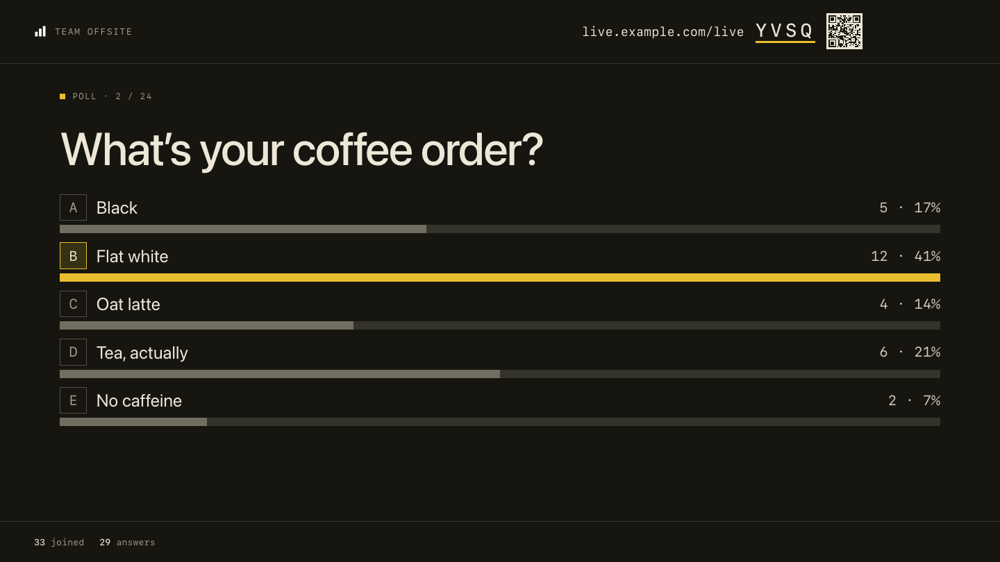<br><b>Poll</b> · bars, columns or a donut</td>
    <td width="33%">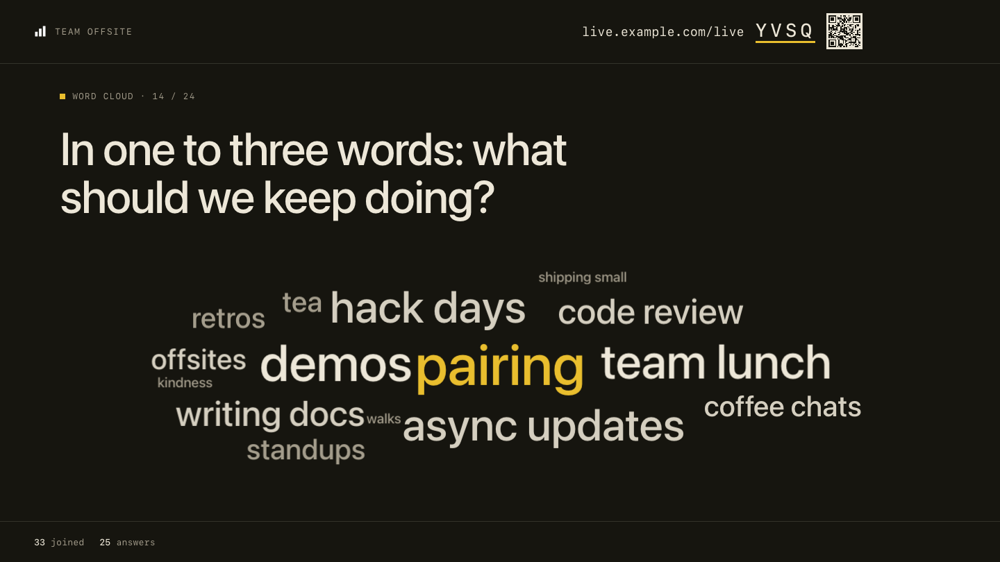<br><b>Word cloud</b> · up to three words each</td>
    <td width="33%">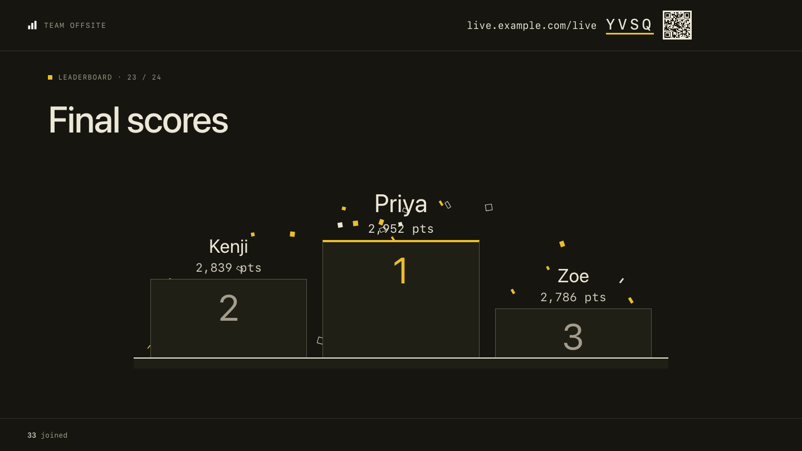<br><b>Quiz</b> · timed, scored, with a podium</td>
  </tr>
  <tr>
    <td>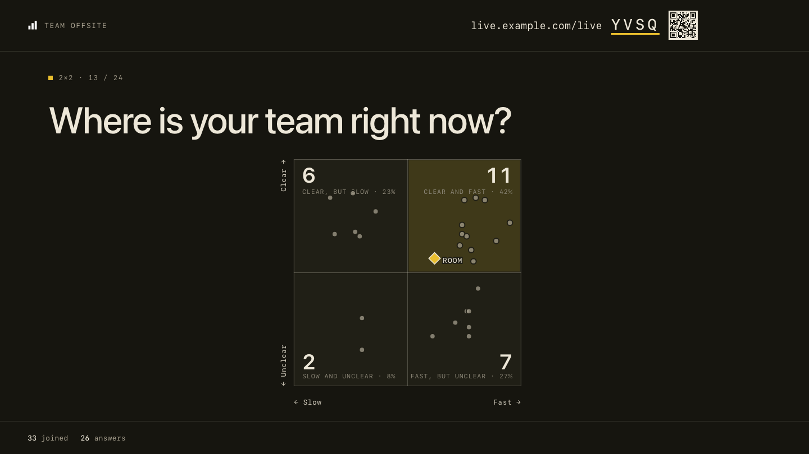<br><b>2×2</b> · every answer a dot</td>
    <td>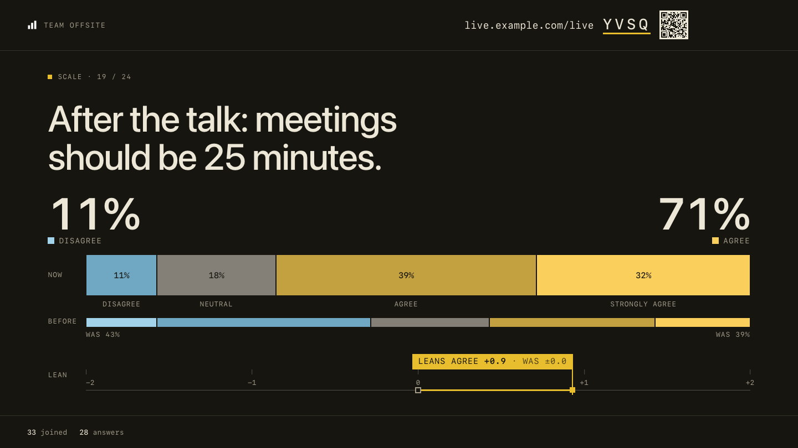<br><b>Agree / disagree</b> · now against before</td>
    <td>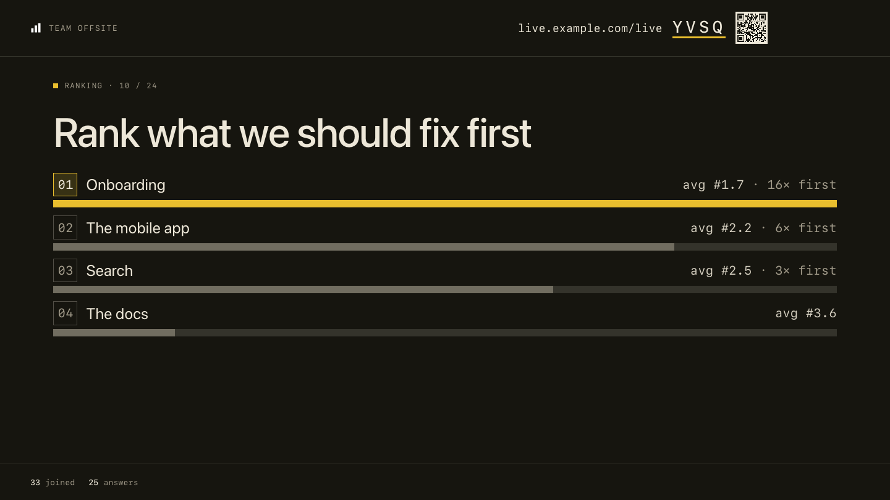<br><b>Ranking</b> · the room's order</td>
  </tr>
  <tr>
    <td>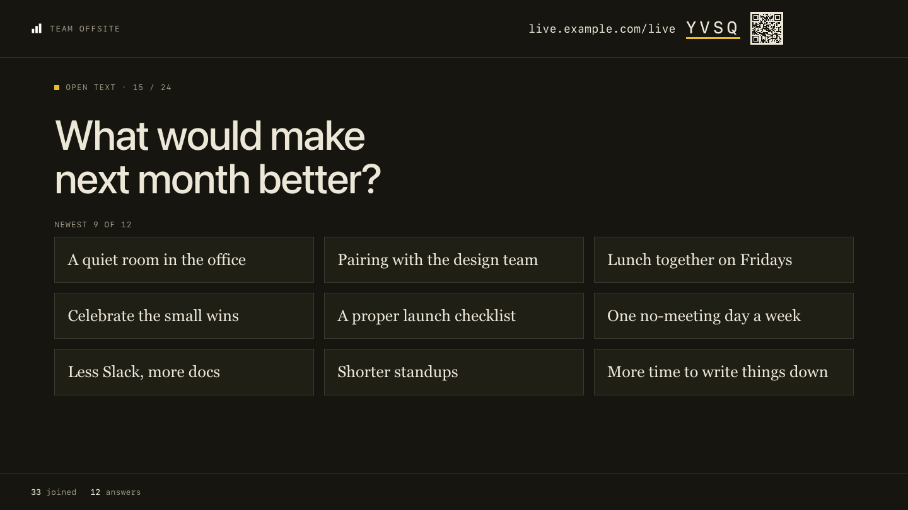<br><b>Open text</b> · spotlight one, hide one</td>
    <td>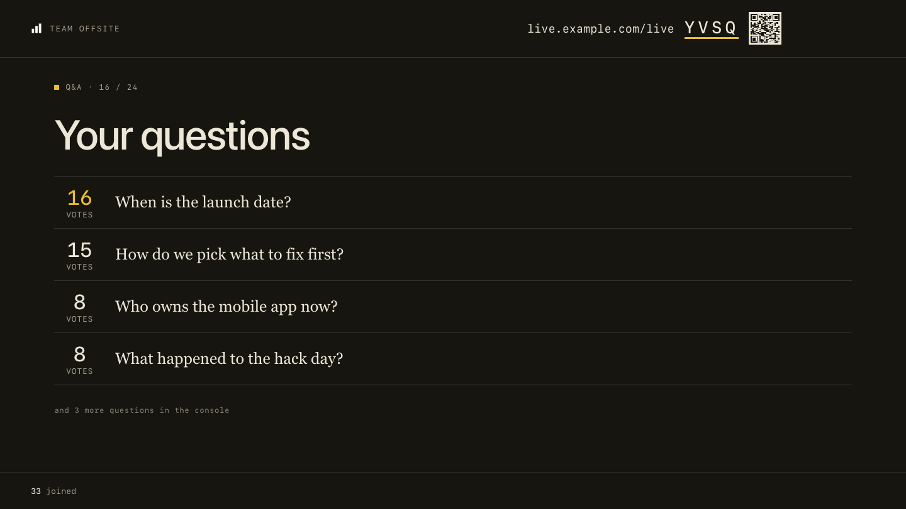<br><b>Q&amp;A</b> · upvotes, mark as answered</td>
    <td>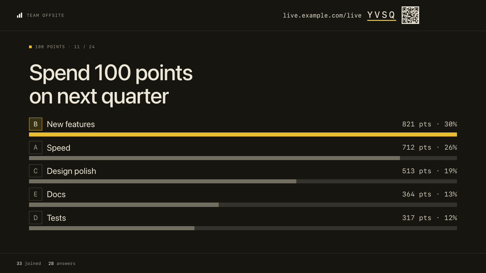<br><b>100 points</b> · where the room puts its weight</td>
  </tr>
</table>

### On the phone

<p align="center">
  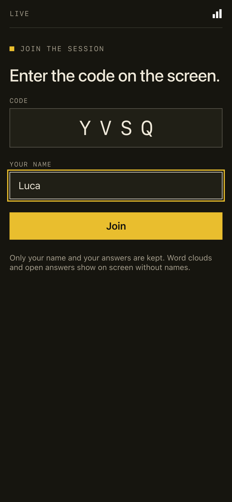&nbsp;
  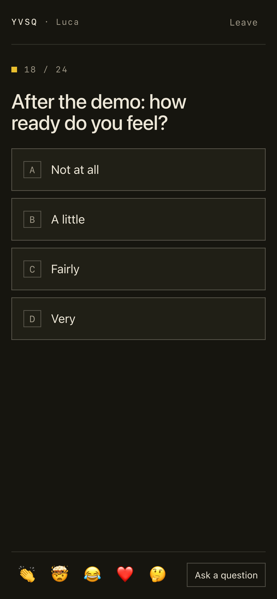&nbsp;
  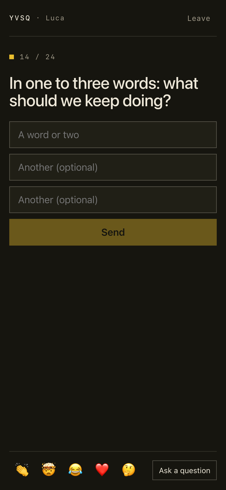
</p>

## Quick start

You need [Node.js](https://nodejs.org) 20.19 or later. You do not need any accounts.

```sh
git clone https://github.com/habit-ai/surprisal-live-kit.git
cd surprisal-live-kit
npm install
npm run dev
```

1. Open the **Network** address that the terminal shows, plus `/live/host`. For example: `http://192.168.1.20:5173/live/host`.
2. Click a template, then click **Go live**.
3. Scan the QR code with a phone on the same Wi-Fi network.

Use the Network address, not `localhost`. The QR code points to the address in your browser, and a phone cannot open
`localhost` on your computer.

**To see every slide type with answers,** run `npm run demo` in a second terminal. It makes a room with 24 slides,
fills it with 32 sample people and prints the presenter link. If the dev server is not on port 5173, set `LIVE_URL`.

The local server keeps everything in memory. A restart deletes all sessions. Anyone who can open the page can go live.
For a real session with people in other places, deploy it.

## Deploy

Vercel and Supabase both have free plans.

### 1. Make the database

1. Make a project at [supabase.com](https://supabase.com).
2. Open **SQL Editor**. Paste all of [`supabase/migrations/0001_live.sql`](supabase/migrations/0001_live.sql). Click **Run**.
3. Open **Project Settings > API**. Copy the **Project URL** and the **service_role** key.

The seven tables have row level security on and no policies. Only the server function can read or write them, with
the service key. Do not put the service key in the browser or in a `VITE_` variable.

### 2. Deploy the app

[](https://vercel.com/new/clone?repository-url=https%3A%2F%2Fgithub.com%2Fhabit-ai%2Fsurprisal-live-kit&project-name=live-kit&repository-name=live-kit&env=SUPABASE_URL,SUPABASE_SERVICE_ROLE_KEY,LIVE_ADMIN_KEY&envDescription=The%20Supabase%20Project%20URL%20and%20service_role%20key%20from%20step%201%2C%20and%20a%20long%20random%20admin%20key%20for%20hosts.&envLink=https%3A%2F%2Fgithub.com%2Fhabit-ai%2Fsurprisal-live-kit%23deploy)

The button copies this repository to your GitHub account and asks for three environment variables. To do it by hand,
import the repository at [vercel.com/new](https://vercel.com/new) and add the same variables before the first deploy.

| Name | Value |
|---|---|
| `SUPABASE_URL` | The Project URL from step 1 |
| `SUPABASE_SERVICE_ROLE_KEY` | The service_role key from step 1 |
| `LIVE_ADMIN_KEY` | A long random string. Make one with `openssl rand -hex 24`. |

Then open `https://your-app.vercel.app/live/host`, click **Connect shared library** and type your `LIVE_ADMIN_KEY`.

Each host types the admin key once per browser. The key lets them go live and share decks in the library. Give it
only to people who host. Phones never need it.

### 3. Put the server near the database

`vercel.json` runs the function in London (`lhr1`), next to a Supabase project in `eu-west-2`. If your Supabase project
is in another region, change `regions` to the nearest [Vercel region](https://vercel.com/docs/edge-network/regions).
Every answer is a round trip from the function to the database, so this changes how fast the screen updates.

## Make it yours

Brand settings are environment variables. Vite reads them at build time, so redeploy after a change. For a local
build, copy `.env.example` to `.env`.

| Name | What it does | Default |
|---|---|---|
| `VITE_BRAND_NAME` | Your name in the top bars, the browser tab and the report | `Live` |
| `VITE_BRAND_LOGO` | A file in `public/` or a full URL. Set it to an empty value to show the name only. | `/logo.svg` |
| `VITE_BRAND_URL` | Where the phone's last screen links to | no link |
| `VITE_JOIN_HOST` | The address the screen shows for phones, for example `live.example.org` | the site's own address |

Colours and fonts are in [`src/styles/theme.css`](src/styles/theme.css). The comment at the top of that file lists
the tokens to change first. Change the dark values too, and keep text at a contrast of 4.5:1 or more.

- A one-colour logo turns white in dark mode. For a colour logo, set `--brand-logo-dark-filter: none` in `theme.css`.
- Replace `public/favicon.svg` with your own icon.
- The templates on the host page are in `TEMPLATES` in [`src/lib/deck.ts`](src/lib/deck.ts).
- The word filter's list is `FLAGGED` in the same file.
- `npm run screenshots` makes the images in this README again, in your colours. The GIF needs `ffmpeg`.

## Run a session

1. Make a deck on the host page, or start from a template. Click **Go live**.
2. Share the presenter window in your call, or put it on the projector. Keep the window uncovered: a hidden tab stops updating.
3. Press **C** to open the console in a second window. To run the session from your phone, scan the console's QR code.
   That link gives full host control, so do not post it in a chat.
4. Move between slides with the arrow keys. Press **R** to reveal or hide the results.
5. After the session, press **End**, then open the **Report**. The report also opens later from the host page.

<details>
<summary><b>Keyboard shortcuts</b></summary>

| Key | Action |
|---|---|
| → / ← (or Page Down / Page Up, Space) | Next / previous slide |
| R | Reveal or hide the results |
| V | Open or close voting |
| T | Restart the slide's timer |
| J | Show the join code full screen |
| C | Open the console |
| F | Full screen |
| S | Sound on or off |
| Esc | Close an overlay |

</details>

The host key for each session is kept in the browser that made it. To present from another browser, open the
console's link (its QR code) there.

## How it works

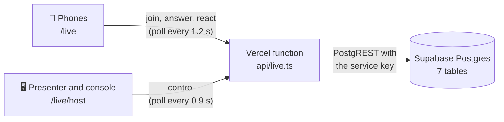

- **No websockets.** Phones and the presenter poll one function. There is no connection to keep open, and it runs on
  the free plans.
- **One handler.** All the server logic is in [`api/_lib/live.ts`](api/_lib/live.ts). It runs on an in-memory store
  for `npm run dev` and the tests, and on Supabase in production.
- **React on the client.** Two pages: [`index.html`](index.html) for phones and [`host.html`](host.html) for
  the host library, editor, presenter, console and report.

### Tested with a full room

On surprisal.to, this code ran a load test with 45 phones at a normal pace and 150 phones that all answered within
2 seconds. No answers were lost. The 95th percentile was 288 ms for an answer and 150 ms for a room poll.

```sh
npm test                        # 32 tests on the server logic, in memory
npx playwright install chromium # once
npm run smoke                   # one whole session in a real browser: host, phone, poll, reveal, reaction, end
npm run build                   # type check and production build
```

GitHub Actions runs all three on every push and pull request.

## Roadmap and known issues

Help is welcome on any of these. See [CONTRIBUTING.md](.github/CONTRIBUTING.md).

- [ ] Two hand-over links opened at the same moment in one browser can drop one session from the host page's list.
  Open them one at a time for now.
- [ ] A session opened from a hand-over link shows as "Live session" on the host page, not with its deck title.
- [ ] At window sizes of 1440×790 or less, a 6-option poll and the prediction chart can run under the bottom bar.
- [ ] The rate limits are kept per server instance, so they slow abuse but are not a hard wall.
- [ ] Names under reactions (the server does not send them yet).
- [ ] Push instead of polling, for rooms of many hundreds.
- [ ] The word filter in more languages.

## Contributing

Bug reports, fixes and new slide types are welcome. [CONTRIBUTING.md](.github/CONTRIBUTING.md) shows how to run it, where
the code is and which checks to run before a pull request. To report a security problem, read [SECURITY.md](.github/SECURITY.md).
Everyone who takes part follows the [code of conduct](.github/CODE_OF_CONDUCT.md).

## License

MIT. See [LICENSE](LICENSE).

[Surprisal](https://surprisal.to) made it for its member sessions and webinars, and this kit is the same code without
the Surprisal brand. If you run it for your community, we would like to hear about it. If it is useful to you, a ⭐
helps other people find it.
